# Inside AlphaEvolve: How does Google DeepMind’s coding agent discover new algorithms?

> “Could it come up with a new leap like the Transformers architecture?”
>
> — Demis Hassabis, Google DeepMind co-founder, discussing what systems like AlphaEvolve could discover. [Lex Fridman Podcast #475, 1:02:03](https://www.lexfridman.com/demis-hassabis-2-transcript/)

AI can suggest a dozen changes to a research program in minutes. Finding out which ones help can take much longer. During a PhD, that work can mean writing a new version of an algorithm, running the same tests again, and trying to remember which change produced which result.

AlphaEvolve automates part of that cycle. In their 2025 paper, Novikov and colleagues at Google DeepMind describe a system in which a language model proposes code edits, an evaluator tests the resulting program, and a search loop uses those results to pick what to try next. The researcher supplies the starting program and decides what counts as a better result. [Novikov et al., §2](https://arxiv.org/abs/2506.13131)

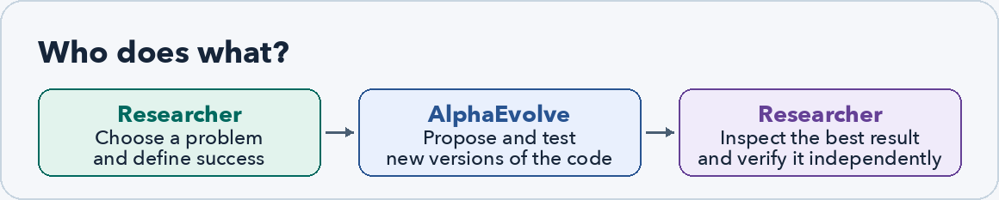

In my PhD research, I’d start by defining the problem. Sometimes I asked an LLM for ideas, picked a promising one, and asked GPT to implement it. Other times I found an approach in a paper or documentation and wrote or adapted the code. Either way, I ran my own tests to see how well the approach worked.

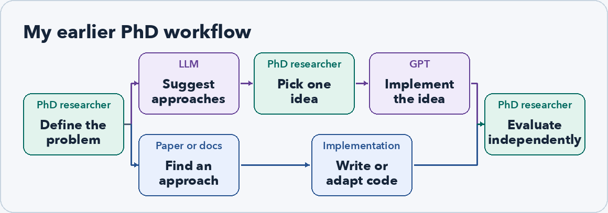

## Part 1. What is AlphaEvolve, and what has it achieved?

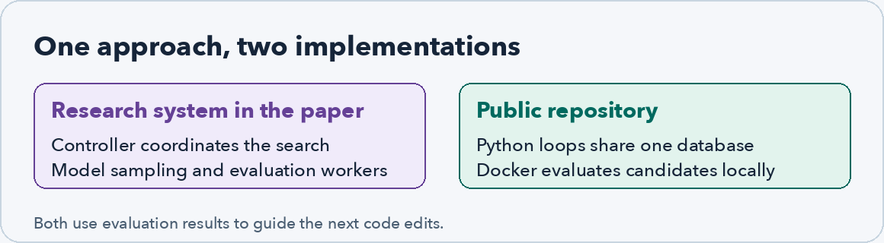

### 1.1 How is the AlphaEvolve repository organized?

The paper describes a distributed system with a pool of evaluators. Google DeepMind’s public repository provides a smaller implementation that runs evaluations locally. Its entry point, `src/run.py`, reads a YAML file that specifies the problem, the starting program, the main score, and the search budget. `src/alpha_evolve.py` runs the search loop. The components in `src/components/` choose programs, build prompts, call Gemini, apply edits, run evaluations, and log results. The `maths/`, `matmul_tensor_decompositions/`, and `omega/` directories contain experiment inputs or verification material. [Paper, §§2.1–2.6](https://arxiv.org/abs/2506.13131) · [Public repository](https://github.com/google-deepmind/alphaevolve)

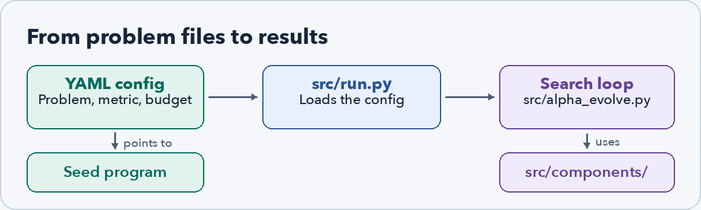

### 1.2 What kinds of problems has AlphaEvolve helped solve?

- **Matrix multiplication.** An evolved search program found a way to multiply two 4 × 4 complex-valued matrices with 48 scalar multiplications. Applying Strassen’s algorithm recursively takes 49. [Paper, §3.1](https://arxiv.org/abs/2506.13131)
- **Mathematical constructions.** Across more than 50 selected problems, the authors report matching the best known construction in about 75% of cases and improving it in about 20%. Examples include packing circles in a square and fitting more non-overlapping spheres around a central sphere in 11 dimensions, with each sphere touching the central one. [Paper, §3.2 and Appendix B](https://arxiv.org/abs/2506.13131)
- **Data center scheduling.** AlphaEvolve found a new rule for choosing where to run jobs. Google reports that the rule recovered, on average, 0.7% of fleet-wide computing resources that would otherwise have gone unused. [Paper, §3.3.1](https://arxiv.org/abs/2506.13131)

These tasks all give the system a way to check a proposed change automatically. For the circle-packing problem, a program can check whether the arrangement is valid and then add up the radii.

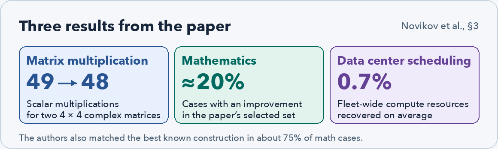

## Part 2. How does AlphaEvolve find a better circle packing?

Imagine placing 28 circles of different sizes inside a unit square. They must fit within the square and avoid overlapping. The goal is to make the **sum of their radii** as large as possible. The demo starts with a simple program that places circles in a pattern. The walkthrough below uses the saved run in this checkout. In the paper, the authors report improved square packings for 26 and 32 circles. [Demo configuration](src/data/problem_config/circle_packing.yaml) · [Saved run](2026-11-17_11-39-05_circle_packing/overview.md) · [Paper, Appendix B.12](https://arxiv.org/abs/2506.13131)

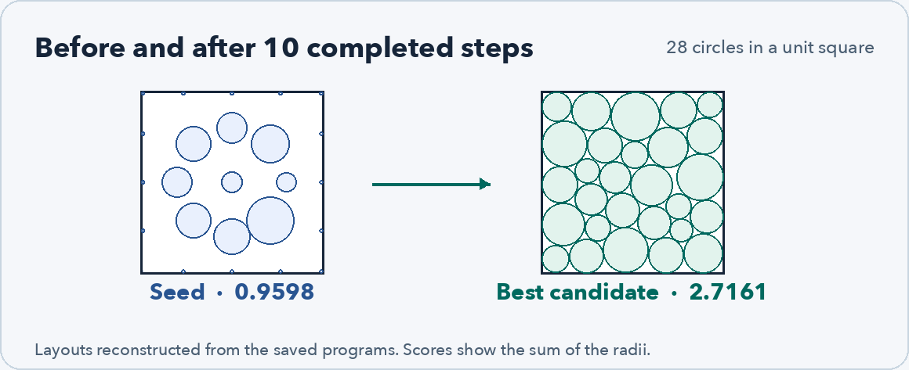

### 2.1 What happens in one search step?

AlphaEvolve evaluates the starting program, called the **seed**, before the search begins. Each step draws one program to edit, called the **parent**, and may also draw past programs for inspiration. The step ends by sending the evaluated program back to the database, which decides where to keep it. When the search ends, AlphaEvolve returns the best program for the main score. [Search loop](src/alpha_evolve.py)

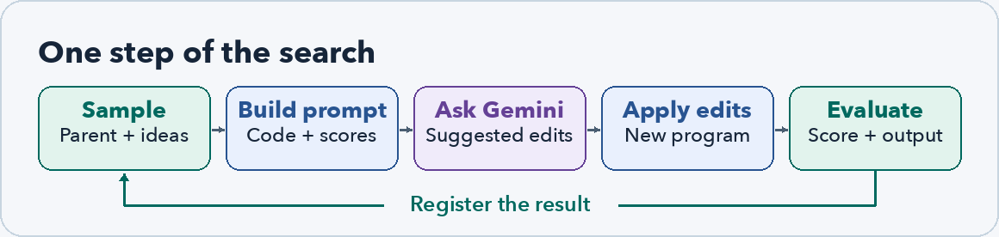

### 2.2 Why call it a prompt sampler?

The prompt changes from step to step. It includes the problem description, the parent’s editable code and score, and up to four other programs with their scores. The sampler also picks wording from a set of options. One prompt might ask the model to combine ideas from earlier programs. Another might ask it to try a new optimization idea. Varying the examples and instructions gives the model different starting points. [Prompt sampler](src/components/prompting.py)

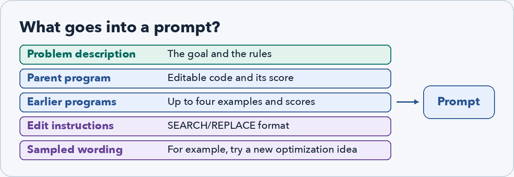

### 2.3 What does the language model do?

The Gemini client sends the prompt and receives proposed code edits. The model can adjust a small part of the code or introduce a different algorithm. In circle packing, for example, it can try staggered rows as a starting arrangement and add a numerical optimizer to move the circles. The evaluator then measures the effect of those changes. The client supports choosing among models with different probabilities, and the saved demo used one Gemini model. [Gemini client](src/components/llm_client.py) · [Saved run](2026-11-17_11-39-05_circle_packing/overview.md)

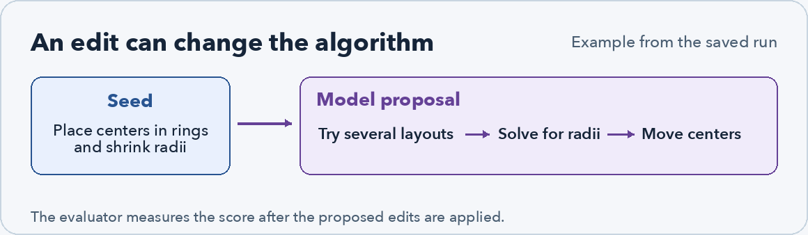

### 2.4 How does AlphaEvolve limit what the model can edit?

The model is asked to return `SEARCH` and `REPLACE` pairs. Each pair identifies a piece of existing code and supplies its replacement. The parser applies these edits inside regions marked `EVOLVE-BLOCK-START` and `EVOLVE-BLOCK-END`. In the demo, this keeps the source of `evaluate()` outside the editable region. An edit whose search text matches nothing can be skipped, so the loop can spend a step evaluating an unchanged program. [Patch parser](src/components/parsing_utils.py) · [Demo program](src/data/initial_programs/circle_packing.py)

### 2.5 How does AlphaEvolve balance exploitation and exploration?

**Exploitation** means improving a program that already scores well. **Exploration** means trying other approaches that might lead to something better later. In the local database, each step has an equal chance of sampling from the best programs or from one of five groups called **islands**. An island favors strong programs when drawing a parent, while giving weaker programs a chance. Each island starts with the same seed and can develop a different set of candidates. [Selection code](src/components/evolution_database.py)

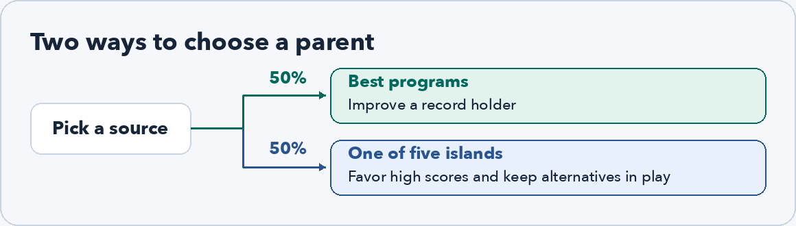

### 2.6 What does the program database store?

The local database is a Python object in memory. Each record holds the full program, its scores, and any output saved by the evaluator. The database keeps a record holder for each score. When a parent comes from an island, its evaluated child joins that island even if it scores worse. A child of a record holder sampled from the best-program list earns a place in the database by setting a record. [Program database](src/components/evolution_database.py)

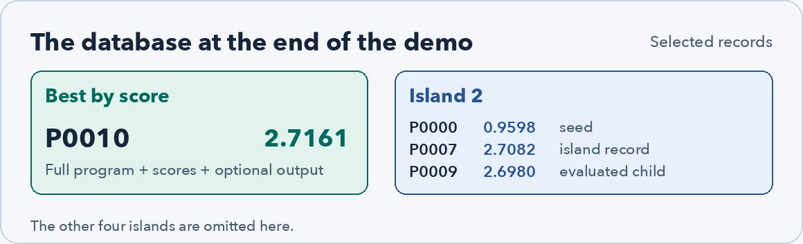

### 2.7 Why does AlphaEvolve evaluate programs in Docker?

Each candidate runs in a fresh container with the same installed dependencies. This isolates generated code from the rest of the experiment and makes it easier to compare candidates in the same environment. The container has networking disabled and limits on memory, CPU, and execution time. The evaluator calls `evaluate()` and reads its scores and any optional output. For the 28-circle demo, `evaluate()` checks that the circles fit inside the square and do not overlap, then adds the radii. Invalid packings receive a score of negative infinity. [Docker evaluator](src/components/evaluator_client.py) · [Circle-packing evaluator](src/data/initial_programs/circle_packing.py)

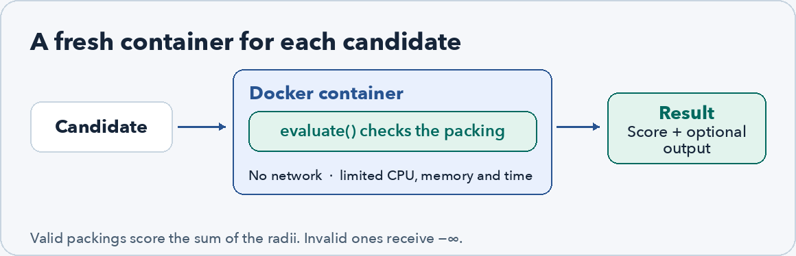

### 2.8 How do new programs build on earlier ideas?

A child starts with the parent’s code. Other sampled programs can contribute ideas through the prompt. The evaluator can also pass a parent’s saved output to its child. In a search that saves circle centers, for example, the next program can start from those positions. The 28-circle demo evolves the constructor itself. [Search loop](src/alpha_evolve.py) · [Circle-packing search example](maths/circle_packing/initial_program.py)

In the saved demo, the seed scored **0.9598**. After several invalid candidates, one version used linear programming to choose radii for fixed centers and a numerical optimizer to adjust the arrangement. It scored **2.7082** and became the new record holder. A later step used that program as its parent, tried more staggered starting layouts, adjusted the optimizer, and reached **2.7161**. That was the best score in the saved run. [Run timeline](2026-11-17_11-39-05_circle_packing/overview.md#step-timeline) · [Edits and evaluations](2026-11-17_11-39-05_circle_packing/coroutine_1.md#step-c1-005)

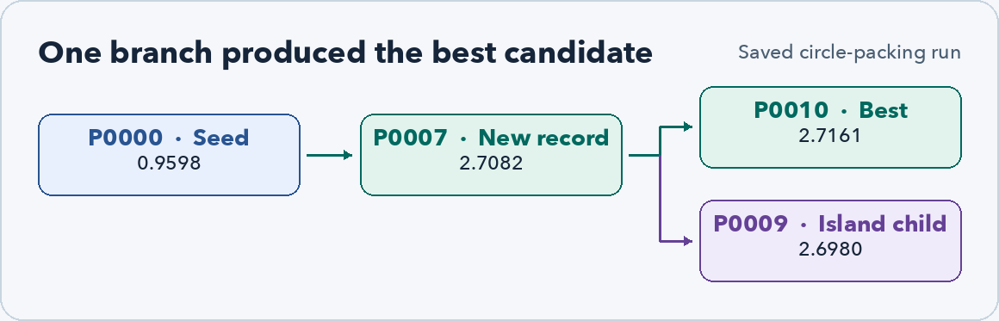

### 2.9 Why does AlphaEvolve rebuild its islands?

With the default settings, the first registration after two hours triggers a reset. The database takes up to five programs from each island, with a strong preference for that island’s best program on the first draw. It removes duplicates and distributes the selected programs across fresh islands. This gives one island a chance to build on ideas from another and clears out much of the old population. The record holders are kept separately. [Island reset code](src/components/evolution_database.py#L252)

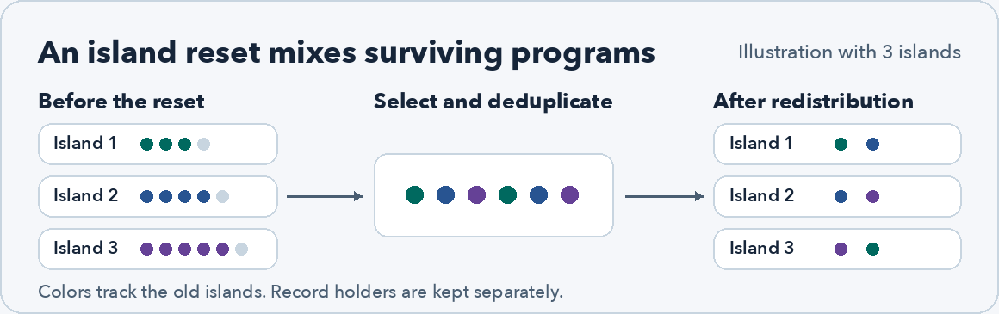

### 2.10 Why does AlphaEvolve use `asyncio`?

An API request and a Docker evaluation can both take time. `asyncio` lets another search step make progress while one is waiting. The loops share the same database, so a newly scored program can become a parent as soon as it is registered. They also share a budget. In the saved run, two loops finished ten counted steps. One extra model call had already started when the run reached its limit, and that step was cancelled. [Search loop](src/alpha_evolve.py) · [Run summary](2026-11-17_11-39-05_circle_packing/overview.md#final-summary)

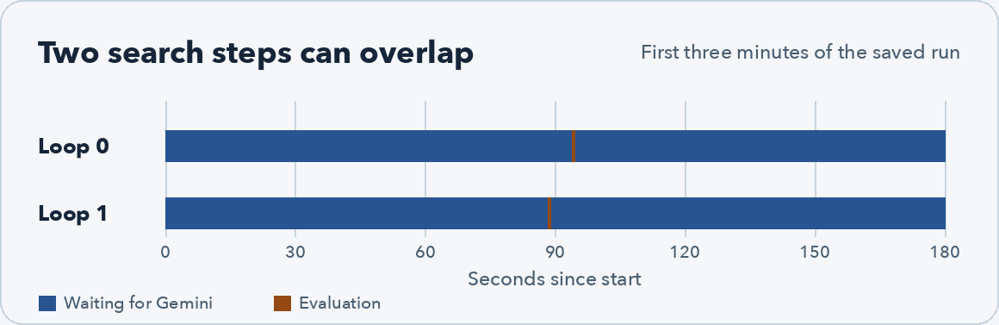

## Part 3. How could researchers use AlphaEvolve in their own work?

For a PhD project, I would start with one part of an experiment that is easy to measure. Suppose I want a faster data loader. I could give the agent the current loader, test that each version returns the expected examples, and measure how long it takes to process a fixed workload. A promising edit could then be checked on another machine or a larger dataset.

The same workflow could help test new training rules or numerical methods. Researchers would still choose the question, decide which comparisons are fair, and study why an improvement works. A log of the experiments makes it easier to turn a strong result into a follow-up question.

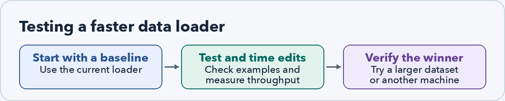

## Part 4. What are the limits of AlphaEvolve?

- **The score guides the search.** A program can do well on a narrow test and perform poorly on new inputs. An independent test can check whether an apparent improvement holds up. For a mathematical construction, an independent verifier can check whether it meets all the stated conditions.
- **Experiments have a cost.** Model calls and evaluations take time and compute. When candidates train a model or run a long simulation, the paper’s staged evaluation approach can screen candidates with cheaper tests before running expensive ones. [Paper, §2.4](https://arxiv.org/abs/2506.13131)
- **Logs and checkpoints serve different purposes.** `LocalLogger` prints progress to the console. The `VerboseFileLogger` in this checkout writes Markdown traces, so records already written can survive shutdown. The search population lives in memory, and the runner has no built-in way to resume it from those logs. [File logger](src/components/verbose_logging.py) · [Runner](src/alpha_evolve.py)

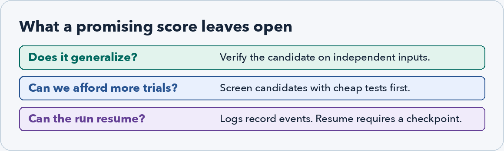

## How could I organize a machine-learning experiment around this workflow?

For a machine-learning experiment, I would keep the part that changes small and make it easy to rerun the tests. A first experiment could evolve an image augmentation policy. The score could be validation accuracy under a fixed training budget, with training time recorded alongside it.

| File or folder | What it holds |
| --- | --- |
| `configs/experiment.yaml` | The task, dataset version, search budget, and main score. |
| `src/candidate.py` | A working baseline with the editable augmentation policy marked. |
| `src/evaluate.py` | The fixed training setup, validation split, seeds, and scoring code. |
| `tests/` | Quick checks for output shape, label handling, and reproducibility. |
| `runs/` | The run configuration, best candidate, scores, and logs. |
| `verify.py` | An independent check of the best candidate against the baseline on held-out data. |

I would first run the evaluator on the baseline, then give the agent a small budget. If it finds an improvement, I would rerun the best candidate and the baseline with the same set of seeds before reporting the result.

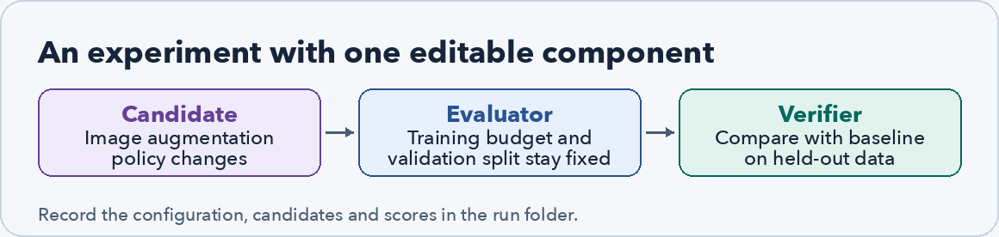

## Where can I find the paper and source code?

1. A. Novikov et al. (2025), [*AlphaEvolve: A coding agent for scientific and algorithmic discovery*](https://doi.org/10.48550/arXiv.2506.13131). arXiv:2506.13131.
2. Google DeepMind, [AlphaEvolve source code and verification notebooks](https://github.com/google-deepmind/alphaevolve).

