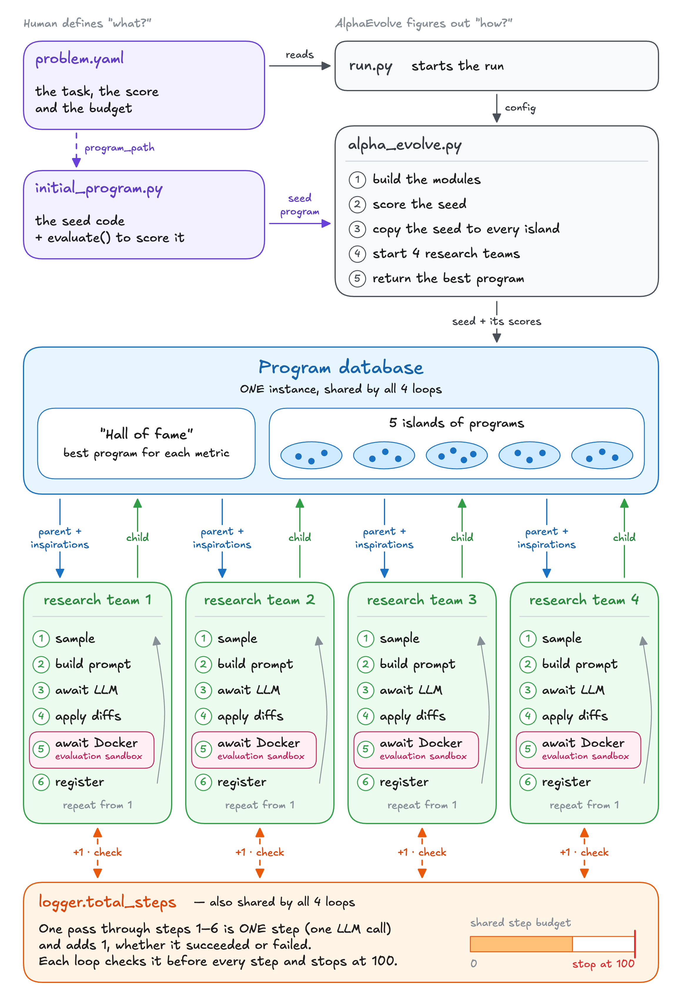
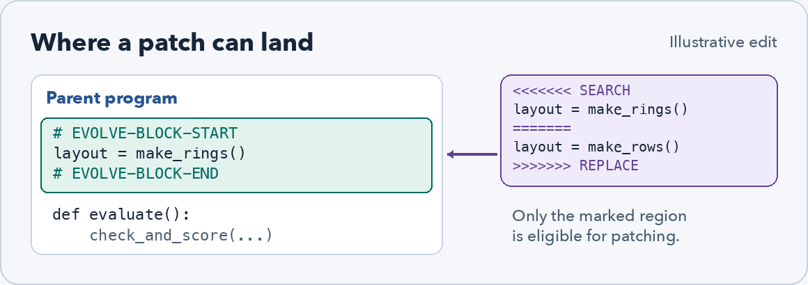

# Inside AlphaEvolve: How does Google DeepMind’s coding agent discover new algorithms?

> “Could it come up with a new leap like the Transformers architecture?”
>
> — Demis Hassabis, Google DeepMind co-founder, discussing what systems like AlphaEvolve could discover. [Lex Fridman Podcast #475, 1:02:03](https://www.lexfridman.com/demis-hassabis-2-transcript/)

AI for research is one of the most important topics in 2026. As a PhD student, I am either someone who will be disrupted by it or someone who can leverage it to boast of greater productivity and fruitful research output. Setting aside the moral and ethical issues that AI may introduce into society as a whole (we can discuss in another article), there is a more practical question that goes to the heart of human curiosity: how can AI actually assist in research? AlphaEvolve, released by Google DeepMind, is one of the most important works in this area recently. But before explaining how it works, let's first take a short look at my previous workflow in my daily research.

<em>Figure 1. My earlier PhD workflow.</em>

The first problem with this workflow is that, as I use AI more and more, I find I miss many good ideas buried in my chat history. The second problem is that this process is not efficient enough: every time I implement a method, I have to decide whether I need to understand it first. Why do I say that? Because when you are driven by tight deadlines and frequent progress meetings, you often don't have enough time to understand a proposal before you have to present it.

<em>Figure 2. Who does what when working with AlphaEvolve.</em>

AlphaEvolve automates part of that cycle. In their 2025 paper, Novikov and colleagues at Google DeepMind describe a system in which a language model proposes code edits, an evaluator tests the resulting program, and a search loop uses those results to pick what to try next. The researcher supplies the starting program and decides what counts as a better result. [Novikov et al., §2](https://arxiv.org/abs/2506.13131). I will discuss the limitations and its potential optimizations to fit for a daily research workflow at the end of this article, but let's first learn what is alphaevolve.

To emphasize, this article is **not about an AI that does everything for you** as a researcher or PhD student. It is about how AI can speed up your daily research workflow. At the end of the day, **AI will not** replace you in **understanding** the problem, the solution and the path how to get there. That is a part you should insist on doing yourself.

## Part 1. What is AlphaEvolve, and what has it achieved?

### 1.1 What kinds of problems has AlphaEvolve helped solve?

- **Matrix multiplication.** An evolved search program found a way to multiply two 4 × 4 complex-valued matrices with 48 scalar multiplications. Applying Strassen’s algorithm recursively takes 49. [Paper, §3.1](https://arxiv.org/abs/2506.13131)
- **Mathematical constructions.** Across more than 50 selected problems, the authors report matching the best known construction in about 75% of cases and improving it in about 20%. [Paper, §3.2 and Appendix B](https://arxiv.org/abs/2506.13131)
- **Data center scheduling.** AlphaEvolve found a new rule for choosing where to run jobs. Google reports that the rule recovered, on average, 0.7% of fleet-wide computing resources that would otherwise have gone unused. [Paper, §3.3.1](https://arxiv.org/abs/2506.13131)

<em>Figure 3. Three results reported in the AlphaEvolve paper.</em>

## Part 2. How does AlphaEvolve find a better algorithm? A circle packing example.

### 2.1 What is the circle packing problem described in the paper?
Imagine placing $n$ circles of different sizes inside a unit square, the square $[0, 1]^2$ whose sides have length 1. The goal is to make the sum of radius as large as possible:

$$
\begin{aligned}
\text{maximize} \quad & \sum_{i=1}^{n} r_i \\
\text{subject to} \quad & r_i \le x_i \le 1 - r_i, \quad r_i \le y_i \le 1 - r_i, && i = 1, \dots, n, \\
& \sqrt{(x_i - x_j)^2 + (y_i - y_j)^2} \ \ge\ r_i + r_j, && 1 \le i < j \le n, \\
& r_i \ge 0, && i = 1, \dots, n.
\end{aligned}
$$

Each constraint has a simple meaning:

- **Inside the square.** A circle's centre must be at least one radius away from every side.
- **No overlap.** Circles may touch, but they may not overlap.
- **Non-negative radii.** A circle can shrink to a point, but its radius cannot be negative.

<em>Figure 5. The 28-circle packing before and after 10 search steps.</em>

### 2.2 How does AlphaEvolve approach the problem?

<em>Figure 4. Overall architecture of AlphaEvolve.</em>

### 2.6 What does the program database store?

The local database is a Python object in memory. Each record holds the full program, its scores, and any output saved by the evaluator. The database keeps a record holder for each score. When a parent comes from an island, its evaluated child joins that island even if it scores worse. A child of a record holder sampled from the best-program list earns a place in the database by setting a record. [Program database](src/components/evolution_database.py)

<em>Figure 11. The program database at the end of the demo.</em>

### 2.1 What happens in one search step?

AlphaEvolve evaluates the starting program, called the **seed**, before the search begins. Each step draws one program to edit, called the **parent**, and may also draw past programs for inspiration. The step ends by sending the evaluated program back to the database, which decides where to keep it. When the search ends, AlphaEvolve returns the best program for the main score. [Search loop](src/alpha_evolve.py)

<em>Figure 6. One step of the search.</em>

### 2.3 What does the language model do?

The Gemini client sends the prompt and receives proposed code edits. The model can adjust a small part of the code or introduce a different algorithm. In circle packing, for example, it can try staggered rows as a starting arrangement and add a numerical optimizer to move the circles. The evaluator then measures the effect of those changes. The client supports choosing among models with different probabilities, and the saved demo used one Gemini model. [Gemini client](src/components/llm_client.py) · [Saved run](2026-11-17_11-39-05_circle_packing/overview.md)

### 2.4 How does AlphaEvolve limit what the model can edit?

The model is asked to return `SEARCH` and `REPLACE` pairs. Each pair identifies a piece of existing code and supplies its replacement. The parser applies these edits inside regions marked `EVOLVE-BLOCK-START` and `EVOLVE-BLOCK-END`. In the demo, this keeps the source of `evaluate()` outside the editable region. An edit whose search text matches nothing can be skipped, so the loop can spend a step evaluating an unchanged program. [Patch parser](src/components/parsing_utils.py) · [Demo program](src/data/initial_programs/circle_packing.py)

<em>Figure 9. Where a SEARCH/REPLACE patch can land.</em>

### 2.5 How does AlphaEvolve balance exploitation and exploration?

**Exploitation** means improving a program that already scores well. **Exploration** means trying other approaches that might lead to something better later. In the local database, each step has an equal chance of sampling from the best programs or from one of five groups called **islands**. An island favors strong programs when drawing a parent, while giving weaker programs a chance. Each island starts with the same seed and can develop a different set of candidates. [Selection code](src/components/evolution_database.py)

<em>Figure 10. Two ways to choose a parent.</em>

### 2.7 Why does AlphaEvolve evaluate programs in Docker?

Each candidate runs in a fresh container with the same installed dependencies. This isolates generated code from the rest of the experiment and makes it easier to compare candidates in the same environment. The container has networking disabled and limits on memory, CPU, and execution time. The evaluator calls `evaluate()` and reads its scores and any optional output. For the 28-circle demo, `evaluate()` checks that the circles fit inside the square and do not overlap, then adds the radii. Invalid packings receive a score of negative infinity. [Docker evaluator](src/components/evaluator_client.py) · [Circle-packing evaluator](src/data/initial_programs/circle_packing.py)

### 2.8 How do new programs build on earlier ideas?

A child starts with the parent’s code. Other sampled programs can contribute ideas through the prompt. The evaluator can also pass a parent’s saved output to its child. In a search that saves circle centers, for example, the next program can start from those positions. The 28-circle demo evolves the constructor itself. [Search loop](src/alpha_evolve.py) · [Circle-packing search example](maths/circle_packing/initial_program.py)

In the saved demo, the seed scored **0.9598**. After several invalid candidates, one version used linear programming to choose radii for fixed centers and a numerical optimizer to adjust the arrangement. It scored **2.7082** and became the new record holder. A later step used that program as its parent, tried more staggered starting layouts, adjusted the optimizer, and reached **2.7161**. That was the best score in the saved run. [Run timeline](2026-11-17_11-39-05_circle_packing/overview.md#step-timeline) · [Edits and evaluations](2026-11-17_11-39-05_circle_packing/coroutine_1.md#step-c1-005)

<em>Figure 13. The branch that produced the best candidate.</em>

### 2.10 Why does AlphaEvolve use `asyncio` module?

An API request and a Docker evaluation can both take time. `asyncio` lets another search step make progress while one is waiting. The loops share the same database, so a newly scored program can become a parent as soon as it is registered. They also share a budget. In the saved run, two loops finished ten counted steps. One extra model call had already started when the run reached its limit, and that step was cancelled. [Search loop](src/alpha_evolve.py) · [Run summary](2026-11-17_11-39-05_circle_packing/overview.md#final-summary)

## Part 3. What are the limits of AlphaEvolve?

- **The score guides the search.** A program can do well on a narrow test and perform poorly on new inputs. An independent test can check whether an apparent improvement holds up. For a mathematical construction, an independent verifier can check whether it meets all the stated conditions.
- **Experiments have a cost.** Model calls and evaluations take time and compute. When candidates train a model or run a long simulation, the paper’s staged evaluation approach can screen candidates with cheaper tests before running expensive ones. [Paper, §2.4](https://arxiv.org/abs/2506.13131)
- **Logs and checkpoints serve different purposes.** `LocalLogger` prints progress to the console. The `VerboseFileLogger` in this checkout writes Markdown traces, so records already written can survive shutdown. The search population lives in memory, and the runner has no built-in way to resume it from those logs. [File logger](src/components/verbose_logging.py) · [Runner](src/alpha_evolve.py)

## Part 4. A new project template for research integrating AlphaEvolve

For a machine-learning experiment, I would keep the part that changes small and make it easy to rerun the tests. A first experiment could evolve an image augmentation policy. The score could be validation accuracy under a fixed training budget, with training time recorded alongside it.

| File or folder | What it holds |
| --- | --- |
| `configs/experiment.yaml` | The task, dataset version, search budget, and main score. |
| `src/candidate.py` | A working baseline with the editable augmentation policy marked. |
| `src/evaluate.py` | The fixed training setup, validation split, seeds, and scoring code. |
| `tests/` | Quick checks for output shape, label handling, and reproducibility. |
| `runs/` | The run configuration, best candidate, scores, and logs. |
| `verify.py` | An independent check of the best candidate against the baseline on held-out data. |

I would first run the evaluator on the baseline, then give the agent a small budget. If it finds an improvement, I would rerun the best candidate and the baseline with the same set of seeds before reporting the result.

## Acknowledgments
This article is a collaboration with Claude developed by Anthropic, and GPT-6 Astra developed by OpenAI. These models helped me summarize the findings of the AlphaEvolve paper, and all figures were created with their help. The ideas and opinions expressed in this article are my own.

## References
1\. A. Novikov et al. (2025), [*AlphaEvolve: A coding agent for scientific and algorithmic discovery*](https://doi.org/10.48550/arXiv.2506.13131). arXiv:2506.13131.  
2\. Google DeepMind, [AlphaEvolve source code and verification notebooks](https://github.com/google-deepmind/alphaevolve).
